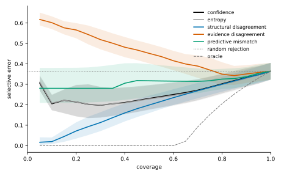
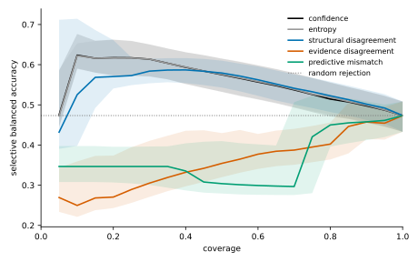
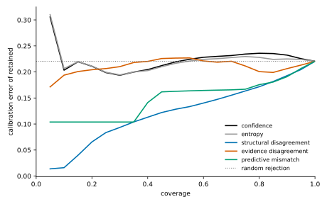
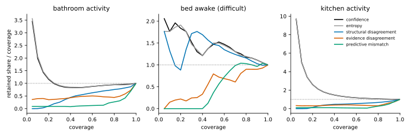

# Phase 4 for the time prior: uncertainty diagnostics against confidence

Phase 4 compared structural uncertainty diagnostics with posterior confidence on the hurdle recursion without the time prior. The reference has since become the fitted channels with the time prior. This pre-specified experiment repeats the comparison on its predictions, with the same signals, ensemble, estimands and decision rule, and picks, by a rule declared before scoring, the signal an abstention rule will use.

This page is generated entirely from the experiment record, `artifacts/phase4/phase4-uncertainty-time-prior.json`, by `sensor_modeling.datasets.prior_uncertainty_summary.render_page`, and the figures by `sensor_modeling.datasets.uncertainty_figures.draw_figures`. A test checks that the committed page is exactly that rendering.

**Status: pre-specified, development panel.**

- **Protocol.** Every signal, estimand, minimal difference and decision rule was frozen before any household was scored.
- **Not a held-out claim.** The development homes have been inspected in earlier work, by Phase 4 among others. The 43 held-out CASAS homes are not scored.
- **Thresholds.** None selected: no coverage level or signal value is chosen for deployment.

## The answer

> Does any structural diagnostic produce a materially better selective-risk curve than confidence for the fitted channels with the time prior, without disproportionately rejecting difficult minority states?

**Yes.** Materially better: `structural_disagreement`.

| Signal | AURC: confidence − signal | 95% interval | Verdict | Minority-state guard | Decision |
| --- | --- | --- | --- | --- | --- |
| `entropy` | +0.002 | [+0.001, +0.002] | negligible | holds | **negligible difference** |
| `structural_disagreement` (structural) | +0.048 | [+0.033, +0.062] | favours signal | holds | **materially better** |
| `evidence_disagreement` (structural) | -0.207 | [-0.228, -0.190] | favours confidence | fails (3) | **worse** |
| `predictive_mismatch` (structural) | -0.067 | [-0.085, -0.050] | favours confidence | fails (3) | **worse** |

The AURC difference is paired by household, and each household counts once. A positive difference favours the signal. The minimal difference is 0.01.

### Read with

- **The guard's reach.** It covers `bed_awake`: 68 windows in 5 households.
- **`structural_disagreement` at the inspection levels.** Error at 0.5: favours signal; balanced accuracy at 0.5: uncertain; error at 0.7: negligible; balanced accuracy at 0.7: uncertain; error at 0.9: negligible; balanced accuracy at 0.9: negligible.
- **`structural_disagreement` and the other minority states.** It retains less than confidence of `bathroom_activity` at 0.5, 0.7, 0.9; `kitchen_activity` at 0.5, 0.7, 0.9: minority states the guard does not cover.

### The abstention rule's signal

`structural_disagreement`: materially better than confidence. The rule, declared before scoring: the structural signal whose decision is materially better, the one with the largest mean AURC difference against confidence when several are; confidence when none is; a tie in that mean goes to the signal first in alphabetical order. Entropy is not a candidate: it ranks windows by the same posterior as confidence, and Phase 4 found it negligibly different.

## Protocol

The protocol is `artifacts/phase4/prior_uncertainty_protocol.json`, SHA-256 `c71a08021a7ea434ee8ef9cacc90e4c87c44e9f3565d9796b648cbb13a342865`.

- **Households.** 20 development homes in the frozen folds of `artifacts/phase1/household_splits.json`. Each home is held out once and scored by models fitted on its fold's training homes.
- **Predictions.** `filter_periodic_hurdle`: the combined-prior recursion: fitted hurdle-Poisson channels with the fold's population parameters and the time prior's transition at each window's hour, the population prior for every held-out household, fed every window of the recording from the prior's distribution at the first window's hour; the predicted state is the posterior's most probable, and every signal ranks these same predictions.
- **Coverage grid.** 0.05 to 1.00 in 20 levels; inspection levels 0.5, 0.7, 0.9.
- **Uncertainty.** Households, never timestamps, are resampled: 2,000 resamples for the pooled curves, 10,000 for the paired comparisons, 95% percentile intervals, seed 0.

### Signals

| Signal | Direction | Missing values | Definition |
| --- | --- | --- | --- |
| `confidence` | `higher_is_safer` | `refuse` | the reference recursion's posterior probability of its predicted state |
| `entropy` | `higher_is_riskier` | `refuse` | the reference posterior's Shannon entropy divided by log of the number of states, in [0, 1] |
| `structural_disagreement` | `higher_is_riskier` | `refuse` | the normalised discordance of the ensemble's posteriors: their generalised Jensen-Shannon divergence in bits over log2 of the number of specifications, in [0, 1] |
| `evidence_disagreement` | `higher_is_riskier` | `reject_first` | the normalised discordance of the identifiable evidence groups of the reference recursion's window: motion (the motion channels), contact (the door channel) and context (the prediction before the window), each group's posterior its channels' fitted likelihoods normalised with no prior; undefined, and rejected first, when fewer than two groups are identifiable |
| `predictive_mismatch` | `higher_is_riskier` | `refuse` | the least standardised surprise over the states: min over s of (-log p(x \| s) minus its mean under s) over its standard deviation under s, with the reference's normalised hurdle count laws |

The structural ensemble is `hurdle/population/all`, `hurdle_nb/population/all`, `hurdle/population/half_a`, `hurdle/population/half_b`: the default ensemble without its pooled specification, which adapts to the household's own labelled windows; a deployed signal has no labels, and a cut-off would change the scored windows of every signal; every specification runs the time prior's recursion, with the fold's prior fitted on all its training households, so only their channel models differ.

### Estimands and decision

- **AURC, the primary estimand.** Primary: each household's error AURC over the grid, confidence minus signal; positive favours the signal.
- **Balanced accuracy over the grid.** Each household's selective balanced accuracy averaged over the grid by the trapezoid rule, signal minus confidence.
- **At each inspection level.** At each inspection coverage, each household's selective balanced accuracy (signal minus confidence), error and calibration error (confidence minus signal).
- **Retained share of each state.** At each inspection coverage, each household's retained share of each state it has, signal minus confidence: negative when the signal rejects the state more.
- **Pairing.** Households with a value under both signals; every household counts once.

| Quantity | Minimal difference |
| --- | --- |
| `aurc` | 0.01 |
| `balanced_accuracy` | 0.02 |
| `balanced_accuracy_area` | 0.02 |
| `calibration_error` | 0.02 |
| `error` | 0.02 |
| `state_coverage` | 0.05 |

- **Verdicts.** Favours signal: mean at least the minimal difference and interval above 0; favours confidence: mean at most minus it and interval below 0; negligible: interval within plus or minus it; uncertain otherwise.
- **Difficult minority states.** A state is a difficult minority state when its share of the scored windows is below 0.1 and the reference's recall on it at full coverage is below the reference's balanced accuracy, both pooled over the scored windows; fixed from the reference's predictions, before any signal is compared.
- **Guard.** A signal disproportionately rejects difficult minority states when, for any such state at any inspection coverage, the paired comparison of its retained share favours confidence: it retains less of the state than confidence does, by at least the minimal difference, with the interval below 0.
- **Absolute bias.** The retained share over the coverage, pooled, is reported for every signal and state: 1 is proportional rejection.
- **Materially better.** The AURC verdict favours the signal and the guard holds.
- **Better but rejects difficult minority states.** The AURC verdict favours the signal and the guard fails.
- **Negligible difference.** The AURC verdict is negligible.
- **Worse.** The AURC verdict favours confidence.
- **Uncertain.** Otherwise.
- **The key question.** Yes when any structural signal is materially better; no otherwise.

## Selective-risk curves

The panel pools 232,975 scored windows. At full coverage the reference's error is 0.364, its balanced accuracy 0.473 and its calibration error 0.221. Random rejection keeps these at every coverage. The oracle's AURC is 0.081.

### Curve summaries, pooled over the panel

| Signal | AURC | 95% interval | Excess over oracle | Gain | 95% interval |
| --- | --- | --- | --- | --- | --- |
| `confidence` | 0.256 | [0.209, 0.308] | 0.175 | 0.383 | [0.282, 0.472] |
| `entropy` | 0.254 | [0.208, 0.306] | 0.174 | 0.388 | [0.288, 0.477] |
| `structural_disagreement` | 0.198 | [0.165, 0.234] | 0.118 | 0.585 | [0.525, 0.647] |
| `evidence_disagreement` | 0.453 | [0.410, 0.494] | 0.373 | -0.314 | [-0.372, -0.260] |
| `predictive_mismatch` | 0.309 | [0.250, 0.382] | 0.229 | 0.195 | [0.054, 0.301] |

Random rejection's AURC is 0.364. The gain is 1 for the oracle and 0 for random rejection.

### Selective error, pooled, at the inspection levels

| Signal | coverage 0.5 | coverage 0.7 | coverage 0.9 |
| --- | --- | --- | --- |
| `confidence` | 0.231 [0.177, 0.296] | 0.272 [0.223, 0.326] | 0.334 [0.289, 0.379] |
| `entropy` | 0.229 [0.174, 0.294] | 0.268 [0.220, 0.323] | 0.330 [0.286, 0.374] |
| `structural_disagreement` | 0.199 [0.159, 0.245] | 0.269 [0.232, 0.307] | 0.332 [0.294, 0.370] |
| `evidence_disagreement` | 0.452 [0.403, 0.499] | 0.389 [0.332, 0.441] | 0.351 [0.307, 0.394] |
| `predictive_mismatch` | 0.317 [0.239, 0.399] | 0.315 [0.256, 0.378] | 0.338 [0.292, 0.384] |

### Selective balanced accuracy, pooled, at the inspection levels

| Signal | coverage 0.5 | coverage 0.7 | coverage 0.9 |
| --- | --- | --- | --- |
| `confidence` | 0.575 [0.532, 0.615] | 0.537 [0.493, 0.579] | 0.497 [0.456, 0.533] |
| `entropy` | 0.576 [0.533, 0.616] | 0.539 [0.495, 0.579] | 0.499 [0.458, 0.534] |
| `structural_disagreement` | 0.579 [0.543, 0.610] | 0.541 [0.501, 0.576] | 0.502 [0.462, 0.537] |
| `evidence_disagreement` | 0.354 [0.320, 0.430] | 0.387 [0.351, 0.440] | 0.457 [0.415, 0.499] |
| `predictive_mismatch` | 0.304 [0.279, 0.410] | 0.297 [0.275, 0.507] | 0.458 [0.412, 0.508] |

### Calibration error of retained predictions, pooled, at the inspection levels

| Signal | coverage 0.5 | coverage 0.7 | coverage 0.9 |
| --- | --- | --- | --- |
| `confidence` | 0.219 | 0.232 | 0.232 |
| `entropy` | 0.217 | 0.228 | 0.225 |
| `structural_disagreement` | 0.128 | 0.155 | 0.193 |
| `evidence_disagreement` | 0.227 | 0.221 | 0.206 |
| `predictive_mismatch` | 0.163 | 0.166 | 0.191 |

### Household coverage under the pooled selection

One threshold over the panel retains different shares of each household. Smallest, median and largest household coverage:

| Signal | coverage 0.5 | coverage 0.7 | coverage 0.9 |
| --- | --- | --- | --- |
| `confidence` | 0.29 / 0.50 / 0.74 | 0.52 / 0.69 / 0.87 | 0.82 / 0.90 / 0.97 |
| `entropy` | 0.29 / 0.50 / 0.75 | 0.52 / 0.69 / 0.88 | 0.85 / 0.90 / 0.99 |
| `structural_disagreement` | 0.25 / 0.51 / 0.65 | 0.53 / 0.71 / 0.79 | 0.83 / 0.90 / 0.95 |
| `evidence_disagreement` | 0.35 / 0.49 / 0.71 | 0.59 / 0.70 / 0.84 | 0.83 / 0.90 / 0.98 |
| `predictive_mismatch` | 0.00 / 0.39 / 0.97 | 0.00 / 0.70 / 0.97 | 0.83 / 0.89 / 0.99 |

Households wholly rejected by the pooled selection: `predictive_mismatch` rejects every window of hh127 at 0.5, 0.7.

## Household-level paired differences

Each household's own curve retains the given fraction of its own windows. Differences are oriented so that a positive value favours the signal over confidence.

| Signal | Quantity | Mean difference | 95% interval | Households | Verdict |
| --- | --- | --- | --- | --- | --- |
| `entropy` | AURC | +0.002 | [+0.001, +0.002] | 20 | negligible |
| `entropy` | balanced accuracy over the grid | +0.000 | [-0.001, +0.001] | 20 | negligible |
| `entropy` | balanced accuracy at 0.5 | +0.000 | [-0.001, +0.003] | 20 | negligible |
| `entropy` | calibration error at 0.5 | +0.003 | [+0.002, +0.004] | 20 | negligible |
| `entropy` | error at 0.5 | +0.003 | [+0.002, +0.004] | 20 | negligible |
| `entropy` | balanced accuracy at 0.7 | -0.000 | [-0.002, +0.001] | 20 | negligible |
| `entropy` | calibration error at 0.7 | +0.004 | [+0.002, +0.006] | 20 | negligible |
| `entropy` | error at 0.7 | +0.003 | [+0.000, +0.005] | 20 | negligible |
| `entropy` | balanced accuracy at 0.9 | +0.000 | [-0.001, +0.002] | 20 | negligible |
| `entropy` | calibration error at 0.9 | +0.005 | [+0.004, +0.006] | 20 | negligible |
| `entropy` | error at 0.9 | +0.002 | [+0.001, +0.003] | 20 | negligible |
| `structural_disagreement` | AURC | +0.048 | [+0.033, +0.062] | 20 | favours signal |
| `structural_disagreement` | balanced accuracy over the grid | +0.018 | [+0.000, +0.037] | 20 | uncertain |
| `structural_disagreement` | balanced accuracy at 0.5 | +0.001 | [-0.021, +0.026] | 20 | uncertain |
| `structural_disagreement` | calibration error at 0.5 | +0.088 | [+0.068, +0.109] | 20 | favours signal |
| `structural_disagreement` | error at 0.5 | +0.028 | [+0.007, +0.051] | 20 | favours signal |
| `structural_disagreement` | balanced accuracy at 0.7 | +0.011 | [-0.005, +0.030] | 20 | uncertain |
| `structural_disagreement` | calibration error at 0.7 | +0.072 | [+0.057, +0.088] | 20 | favours signal |
| `structural_disagreement` | error at 0.7 | +0.004 | [-0.012, +0.019] | 20 | negligible |
| `structural_disagreement` | balanced accuracy at 0.9 | +0.003 | [-0.009, +0.016] | 20 | negligible |
| `structural_disagreement` | calibration error at 0.9 | +0.037 | [+0.030, +0.043] | 20 | favours signal |
| `structural_disagreement` | error at 0.9 | +0.000 | [-0.007, +0.007] | 20 | negligible |
| `evidence_disagreement` | AURC | -0.207 | [-0.228, -0.190] | 20 | favours confidence |
| `evidence_disagreement` | balanced accuracy over the grid | -0.158 | [-0.175, -0.142] | 20 | favours confidence |
| `evidence_disagreement` | balanced accuracy at 0.5 | -0.186 | [-0.208, -0.165] | 20 | favours confidence |
| `evidence_disagreement` | calibration error at 0.5 | -0.023 | [-0.055, +0.006] | 20 | uncertain |
| `evidence_disagreement` | error at 0.5 | -0.231 | [-0.261, -0.203] | 20 | favours confidence |
| `evidence_disagreement` | balanced accuracy at 0.7 | -0.124 | [-0.147, -0.101] | 20 | favours confidence |
| `evidence_disagreement` | calibration error at 0.7 | +0.017 | [+0.003, +0.031] | 20 | uncertain |
| `evidence_disagreement` | error at 0.7 | -0.107 | [-0.121, -0.094] | 20 | favours confidence |
| `evidence_disagreement` | balanced accuracy at 0.9 | -0.034 | [-0.056, -0.017] | 20 | favours confidence |
| `evidence_disagreement` | calibration error at 0.9 | +0.023 | [+0.019, +0.027] | 20 | favours signal |
| `evidence_disagreement` | error at 0.9 | -0.020 | [-0.024, -0.015] | 20 | uncertain |
| `predictive_mismatch` | AURC | -0.067 | [-0.085, -0.050] | 20 | favours confidence |
| `predictive_mismatch` | balanced accuracy over the grid | -0.128 | [-0.160, -0.095] | 20 | favours confidence |
| `predictive_mismatch` | balanced accuracy at 0.5 | -0.184 | [-0.227, -0.140] | 20 | favours confidence |
| `predictive_mismatch` | calibration error at 0.5 | +0.054 | [+0.029, +0.077] | 20 | favours signal |
| `predictive_mismatch` | error at 0.5 | -0.084 | [-0.106, -0.063] | 20 | favours confidence |
| `predictive_mismatch` | balanced accuracy at 0.7 | -0.100 | [-0.139, -0.064] | 20 | favours confidence |
| `predictive_mismatch` | calibration error at 0.7 | +0.069 | [+0.054, +0.084] | 20 | favours signal |
| `predictive_mismatch` | error at 0.7 | -0.038 | [-0.052, -0.025] | 20 | favours confidence |
| `predictive_mismatch` | balanced accuracy at 0.9 | -0.015 | [-0.030, +0.001] | 20 | uncertain |
| `predictive_mismatch` | calibration error at 0.9 | +0.040 | [+0.036, +0.043] | 20 | favours signal |
| `predictive_mismatch` | error at 0.9 | -0.005 | [-0.009, -0.001] | 20 | negligible |

## Rejection bias by behavioural state

### The states

| State | Windows | Households | Share of scored windows | Reference recall | Difficult minority |
| --- | --- | --- | --- | --- | --- |
| `away` | 75,667 | 20 | 32.48% | 0.634 | no |
| `bathroom_activity` | 7,956 | 20 | 3.41% | 0.487 | no |
| `bed_awake` | 68 | 5 | 0.03% | 0.044 | yes |
| `home_active` | 24,837 | 20 | 10.66% | 0.276 | no |
| `home_inactive` | 40,735 | 20 | 17.48% | 0.458 | no |
| `kitchen_activity` | 5,959 | 20 | 2.56% | 0.547 | no |
| `sleeping` | 77,753 | 20 | 33.37% | 0.868 | no |

Difficult minority states: `bed_awake`.

### The other minority states, outside the decision rule

Descriptive only: these states are below the minority share, but the reference's recall on them is not below its balanced accuracy, so the guard does not cover them. Listed are the inspection levels where a signal's paired comparison of the retained share favours confidence.

| Signal | State | Rejected more than under confidence at |
| --- | --- | --- |
| `entropy` | `bathroom_activity` | none |
| `entropy` | `kitchen_activity` | none |
| `structural_disagreement` | `bathroom_activity` | 0.5, 0.7, 0.9 |
| `structural_disagreement` | `kitchen_activity` | 0.5, 0.7, 0.9 |
| `evidence_disagreement` | `bathroom_activity` | 0.5, 0.7, 0.9 |
| `evidence_disagreement` | `kitchen_activity` | 0.5, 0.7, 0.9 |
| `predictive_mismatch` | `bathroom_activity` | 0.5, 0.7, 0.9 |
| `predictive_mismatch` | `kitchen_activity` | 0.5, 0.7, 0.9 |

### Retained share over coverage, pooled, at 0.5

1 is proportional rejection; below 1, the state is rejected more than the panel.

| Signal | `away` | `bathroom_activity` | `bed_awake` | `home_active` | `home_inactive` | `kitchen_activity` | `sleeping` |
| --- | --- | --- | --- | --- | --- | --- | --- |
| `confidence` | 1.02 | 0.83 | 1.47 | 0.84 | 0.71 | 1.29 | 1.18 |
| `entropy` | 1.01 | 0.84 | 1.50 | 0.84 | 0.69 | 1.29 | 1.19 |
| `structural_disagreement` | 1.17 | 0.55 | 1.47 | 0.44 | 0.43 | 0.50 | 1.39 |
| `evidence_disagreement` | 1.11 | 0.48 | 0.79 | 1.02 | 1.25 | 0.41 | 0.85 |
| `predictive_mismatch` | 1.45 | 0.11 | 0.36 | 0.34 | 0.66 | 0.08 | 1.11 |

### Retained share over coverage, pooled, at 0.7

1 is proportional rejection; below 1, the state is rejected more than the panel.

| Signal | `away` | `bathroom_activity` | `bed_awake` | `home_active` | `home_inactive` | `kitchen_activity` | `sleeping` |
| --- | --- | --- | --- | --- | --- | --- | --- |
| `confidence` | 0.99 | 0.92 | 1.30 | 0.94 | 0.88 | 1.10 | 1.09 |
| `entropy` | 1.00 | 0.92 | 1.30 | 0.92 | 0.85 | 1.11 | 1.10 |
| `structural_disagreement` | 1.11 | 0.70 | 1.24 | 0.68 | 0.67 | 0.60 | 1.23 |
| `evidence_disagreement` | 1.17 | 0.47 | 0.61 | 0.87 | 1.05 | 0.34 | 0.95 |
| `predictive_mismatch` | 1.33 | 0.13 | 0.99 | 0.40 | 0.70 | 0.06 | 1.18 |

### Retained share over coverage, pooled, at 0.9

1 is proportional rejection; below 1, the state is rejected more than the panel.

| Signal | `away` | `bathroom_activity` | `bed_awake` | `home_active` | `home_inactive` | `kitchen_activity` | `sleeping` |
| --- | --- | --- | --- | --- | --- | --- | --- |
| `confidence` | 1.00 | 0.96 | 1.11 | 0.99 | 0.97 | 1.03 | 1.02 |
| `entropy` | 1.00 | 0.94 | 1.11 | 0.96 | 0.94 | 1.03 | 1.05 |
| `structural_disagreement` | 1.03 | 0.82 | 1.03 | 0.89 | 0.90 | 0.79 | 1.09 |
| `evidence_disagreement` | 1.08 | 0.58 | 0.90 | 0.90 | 0.99 | 0.62 | 1.03 |
| `predictive_mismatch` | 1.07 | 0.42 | 0.96 | 0.78 | 1.01 | 0.50 | 1.09 |

### Retained share against confidence, paired by household

Signal minus confidence: negative when the signal rejects the state more. The minimal difference is 0.05.

| Signal | Coverage | State | Mean difference | 95% interval | Households | Verdict |
| --- | --- | --- | --- | --- | --- | --- |
| `entropy` | 0.5 | `away` | -0.002 | [-0.005, +0.001] | 20 | negligible |
| `entropy` | 0.5 | `bathroom_activity` | +0.002 | [-0.004, +0.007] | 20 | negligible |
| `entropy` | 0.5 | `bed_awake` (difficult minority) | +0.000 | [+0.000, +0.000] | 5 | negligible |
| `entropy` | 0.5 | `home_active` | -0.005 | [-0.009, -0.001] | 20 | negligible |
| `entropy` | 0.5 | `home_inactive` | -0.011 | [-0.016, -0.006] | 20 | negligible |
| `entropy` | 0.5 | `kitchen_activity` | +0.001 | [-0.003, +0.004] | 20 | negligible |
| `entropy` | 0.5 | `sleeping` | +0.008 | [+0.005, +0.012] | 20 | negligible |
| `entropy` | 0.7 | `away` | -0.004 | [-0.016, +0.007] | 20 | negligible |
| `entropy` | 0.7 | `bathroom_activity` | +0.001 | [-0.011, +0.012] | 20 | negligible |
| `entropy` | 0.7 | `bed_awake` (difficult minority) | -0.007 | [-0.022, +0.000] | 5 | negligible |
| `entropy` | 0.7 | `home_active` | -0.019 | [-0.033, -0.007] | 20 | negligible |
| `entropy` | 0.7 | `home_inactive` | -0.029 | [-0.042, -0.016] | 20 | negligible |
| `entropy` | 0.7 | `kitchen_activity` | +0.000 | [-0.009, +0.008] | 20 | negligible |
| `entropy` | 0.7 | `sleeping` | +0.020 | [+0.007, +0.040] | 20 | negligible |
| `entropy` | 0.9 | `away` | -0.008 | [-0.016, -0.000] | 20 | negligible |
| `entropy` | 0.9 | `bathroom_activity` | -0.007 | [-0.017, +0.003] | 20 | negligible |
| `entropy` | 0.9 | `bed_awake` (difficult minority) | +0.000 | [+0.000, +0.000] | 5 | negligible |
| `entropy` | 0.9 | `home_active` | -0.023 | [-0.032, -0.013] | 20 | negligible |
| `entropy` | 0.9 | `home_inactive` | -0.024 | [-0.037, -0.011] | 20 | negligible |
| `entropy` | 0.9 | `kitchen_activity` | +0.015 | [+0.002, +0.034] | 20 | negligible |
| `entropy` | 0.9 | `sleeping` | +0.019 | [+0.010, +0.029] | 20 | negligible |
| `structural_disagreement` | 0.5 | `away` | +0.133 | [+0.090, +0.179] | 20 | favours signal |
| `structural_disagreement` | 0.5 | `bathroom_activity` | -0.172 | [-0.225, -0.119] | 20 | favours confidence |
| `structural_disagreement` | 0.5 | `bed_awake` (difficult minority) | -0.124 | [-0.400, +0.152] | 5 | uncertain |
| `structural_disagreement` | 0.5 | `home_active` | -0.191 | [-0.235, -0.144] | 20 | favours confidence |
| `structural_disagreement` | 0.5 | `home_inactive` | -0.121 | [-0.153, -0.086] | 20 | favours confidence |
| `structural_disagreement` | 0.5 | `kitchen_activity` | -0.386 | [-0.464, -0.299] | 20 | favours confidence |
| `structural_disagreement` | 0.5 | `sleeping` | +0.093 | [+0.066, +0.121] | 20 | favours signal |
| `structural_disagreement` | 0.7 | `away` | +0.139 | [+0.092, +0.193] | 20 | favours signal |
| `structural_disagreement` | 0.7 | `bathroom_activity` | -0.182 | [-0.236, -0.127] | 20 | favours confidence |
| `structural_disagreement` | 0.7 | `bed_awake` (difficult minority) | -0.117 | [-0.250, +0.000] | 5 | uncertain |
| `structural_disagreement` | 0.7 | `home_active` | -0.162 | [-0.211, -0.110] | 20 | favours confidence |
| `structural_disagreement` | 0.7 | `home_inactive` | -0.117 | [-0.157, -0.076] | 20 | favours confidence |
| `structural_disagreement` | 0.7 | `kitchen_activity` | -0.379 | [-0.447, -0.306] | 20 | favours confidence |
| `structural_disagreement` | 0.7 | `sleeping` | +0.084 | [+0.059, +0.112] | 20 | favours signal |
| `structural_disagreement` | 0.9 | `away` | +0.065 | [+0.038, +0.094] | 20 | favours signal |
| `structural_disagreement` | 0.9 | `bathroom_activity` | -0.148 | [-0.212, -0.089] | 20 | favours confidence |
| `structural_disagreement` | 0.9 | `bed_awake` (difficult minority) | -0.107 | [-0.307, +0.000] | 5 | uncertain |
| `structural_disagreement` | 0.9 | `home_active` | -0.084 | [-0.126, -0.044] | 20 | favours confidence |
| `structural_disagreement` | 0.9 | `home_inactive` | -0.033 | [-0.059, -0.008] | 20 | uncertain |
| `structural_disagreement` | 0.9 | `kitchen_activity` | -0.243 | [-0.300, -0.186] | 20 | favours confidence |
| `structural_disagreement` | 0.9 | `sleeping` | +0.046 | [+0.033, +0.059] | 20 | uncertain |
| `evidence_disagreement` | 0.5 | `away` | +0.183 | [+0.095, +0.281] | 20 | favours signal |
| `evidence_disagreement` | 0.5 | `bathroom_activity` | -0.246 | [-0.341, -0.147] | 20 | favours confidence |
| `evidence_disagreement` | 0.5 | `bed_awake` (difficult minority) | -0.530 | [-0.833, -0.226] | 5 | favours confidence |
| `evidence_disagreement` | 0.5 | `home_active` | +0.061 | [-0.016, +0.144] | 20 | uncertain |
| `evidence_disagreement` | 0.5 | `home_inactive` | +0.245 | [+0.163, +0.331] | 20 | favours signal |
| `evidence_disagreement` | 0.5 | `kitchen_activity` | -0.410 | [-0.562, -0.239] | 20 | favours confidence |
| `evidence_disagreement` | 0.5 | `sleeping` | -0.177 | [-0.287, -0.066] | 20 | favours confidence |
| `evidence_disagreement` | 0.7 | `away` | +0.186 | [+0.105, +0.269] | 20 | favours signal |
| `evidence_disagreement` | 0.7 | `bathroom_activity` | -0.373 | [-0.446, -0.292] | 20 | favours confidence |
| `evidence_disagreement` | 0.7 | `bed_awake` (difficult minority) | -0.615 | [-0.815, -0.463] | 5 | favours confidence |
| `evidence_disagreement` | 0.7 | `home_active` | -0.052 | [-0.125, +0.022] | 20 | uncertain |
| `evidence_disagreement` | 0.7 | `home_inactive` | +0.105 | [+0.037, +0.177] | 20 | favours signal |
| `evidence_disagreement` | 0.7 | `kitchen_activity` | -0.495 | [-0.632, -0.340] | 20 | favours confidence |
| `evidence_disagreement` | 0.7 | `sleeping` | -0.086 | [-0.168, -0.001] | 20 | favours confidence |
| `evidence_disagreement` | 0.9 | `away` | +0.094 | [+0.075, +0.115] | 20 | favours signal |
| `evidence_disagreement` | 0.9 | `bathroom_activity` | -0.370 | [-0.436, -0.300] | 20 | favours confidence |
| `evidence_disagreement` | 0.9 | `bed_awake` (difficult minority) | -0.478 | [-0.767, -0.233] | 5 | favours confidence |
| `evidence_disagreement` | 0.9 | `home_active` | -0.069 | [-0.106, -0.030] | 20 | favours confidence |
| `evidence_disagreement` | 0.9 | `home_inactive` | +0.029 | [+0.006, +0.051] | 20 | uncertain |
| `evidence_disagreement` | 0.9 | `kitchen_activity` | -0.350 | [-0.408, -0.286] | 20 | favours confidence |
| `evidence_disagreement` | 0.9 | `sleeping` | -0.000 | [-0.019, +0.019] | 20 | negligible |
| `predictive_mismatch` | 0.5 | `away` | +0.214 | [+0.154, +0.286] | 20 | favours signal |
| `predictive_mismatch` | 0.5 | `bathroom_activity` | -0.407 | [-0.482, -0.322] | 20 | favours confidence |
| `predictive_mismatch` | 0.5 | `bed_awake` (difficult minority) | -0.551 | [-0.850, -0.187] | 5 | favours confidence |
| `predictive_mismatch` | 0.5 | `home_active` | -0.211 | [-0.294, -0.120] | 20 | favours confidence |
| `predictive_mismatch` | 0.5 | `home_inactive` | +0.004 | [-0.064, +0.078] | 20 | uncertain |
| `predictive_mismatch` | 0.5 | `kitchen_activity` | -0.581 | [-0.701, -0.445] | 20 | favours confidence |
| `predictive_mismatch` | 0.5 | `sleeping` | +0.007 | [-0.058, +0.073] | 20 | uncertain |
| `predictive_mismatch` | 0.7 | `away` | +0.231 | [+0.183, +0.285] | 20 | favours signal |
| `predictive_mismatch` | 0.7 | `bathroom_activity` | -0.559 | [-0.633, -0.476] | 20 | favours confidence |
| `predictive_mismatch` | 0.7 | `bed_awake` (difficult minority) | -0.644 | [-0.933, -0.332] | 5 | favours confidence |
| `predictive_mismatch` | 0.7 | `home_active` | -0.320 | [-0.412, -0.218] | 20 | favours confidence |
| `predictive_mismatch` | 0.7 | `home_inactive` | -0.076 | [-0.148, +0.000] | 20 | uncertain |
| `predictive_mismatch` | 0.7 | `kitchen_activity` | -0.688 | [-0.794, -0.565] | 20 | favours confidence |
| `predictive_mismatch` | 0.7 | `sleeping` | +0.066 | [+0.011, +0.124] | 20 | favours signal |
| `predictive_mismatch` | 0.9 | `away` | +0.078 | [+0.063, +0.095] | 20 | favours signal |
| `predictive_mismatch` | 0.9 | `bathroom_activity` | -0.473 | [-0.543, -0.394] | 20 | favours confidence |
| `predictive_mismatch` | 0.9 | `bed_awake` (difficult minority) | -0.292 | [-0.417, -0.158] | 5 | favours confidence |
| `predictive_mismatch` | 0.9 | `home_active` | -0.184 | [-0.238, -0.131] | 20 | favours confidence |
| `predictive_mismatch` | 0.9 | `home_inactive` | +0.019 | [-0.001, +0.039] | 20 | negligible |
| `predictive_mismatch` | 0.9 | `kitchen_activity` | -0.490 | [-0.560, -0.416] | 20 | favours confidence |
| `predictive_mismatch` | 0.9 | `sleeping` | +0.046 | [+0.022, +0.065] | 20 | uncertain |

## Checks

- **Reproduction.** The fold fits of phase1-fold-a, phase1-fold-b equal the fitted-rates record's to within 1e-06, though not bit for bit: the record was made on another platform, and the ensemble's population is each fold's fitted channels exactly. `filter_periodic_hurdle` gives back the combined-prior record's scores for all 20 households to within 1e-06, bit for bit.
- **Comparator.** Every signal is compared with `confidence` on the same predictions and the same household resamples.

## What this does not show

- A held-out claim: the 20 homes have been inspected in earlier work, by Phase 4 among others.
- A confirmation on the 43 held-out CASAS homes, which are used up for this formulation: its scores in every one of them are published.
- A threshold: none is selected here.
- Uncertainty in the fits: each fold's training homes share one fit, and the household bootstrap resamples the scored homes only.
- Another formulation: every signal ranks the predictions of filter_periodic_hurdle alone.
- An unbiased signal choice: the rule picks the abstention rule's signal on these 20 homes, and the largest mean among several winners is biased upward. No CASAS homes remain untouched to confirm the signal or the rule chosen with it.
- Independence from Phase 4: the homes, windows and folds are the same, and predictive_mismatch is the same window by window; only the predictions and the ensemble's recursion differ.
- A guard with reach: it covers bed_awake, 68 windows in 5 households; windows cluster within homes, and the homes of a fold share one fit.
